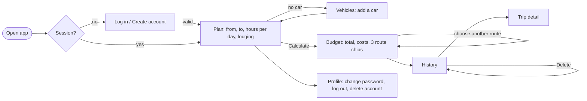

# RouteWise – Android client

Android application of the RouteWise trip-cost planner. It lets a driver register, store cars, choose a start and
a destination, and see what the trip will cost (fuel, road fees, overnight stay) for three route variants. It
talks to the RouteWise REST API described in [`docs/api`](../docs/api/README.md).

Status of this document: it describes the code in this folder. Everything that is not implemented is listed in
[Limitations](#limitations).

## 1. What you can check

| Criterion | Where it is implemented |
|---|---|
| Modern framework | Kotlin + Jetpack Compose + Material 3 (`app/src/main/java/com/routewise/app/ui`) |
| Component-based structure | Screens in `ui/<feature>`, reusable components in `ui/components` (`FormField` with show/hide password and blur validation, `InfoBanner`, `LoadingButton`, skeletons, `ErrorState`, `EmptyState`, `ConfirmDialog`), API and business logic in `data` |
| MVVM | Every screen has a `ViewModel` exposing `StateFlow` state; screens only render state and send events |
| Forms with validation | `ui/auth`, `ui/vehicles`, `ui/plan`, `ui/profile`; the rules are in `domain/Validators.kt` |
| Global error handling | `core/ErrorHandler.kt`, `core/Notifier.kt`, snackbar host in `ui/navigation/RouteWiseRoot.kt` |
| Loading states / skeletons | `ui/components/Components.kt` (`SkeletonList`, `SkeletonBox`, `LoadingButton`) |
| 401 / 403 / 404 / 500 handling | `data/api/ApiException.kt` maps status and error code, `HttpRouteWiseApi` renews the token on 401 |
| Typed API layer | `data/api/ApiModels.kt` (DTOs), `RouteWiseApi.kt` (interface), `HttpRouteWiseApi.kt` (HTTP) |
| No tokens in code | Tokens are received at run time and kept in `EncryptedSharedPreferences` (`data/session/Session.kt`) |
| Unit tests (>= 3 components) | `app/src/test/.../domain`, `.../data`, `.../ui` – 82 tests, see [Tests](#5-tests) |
| UI / e2e tests | `app/src/test/.../ui/AppFlowTest.kt` – 2 tests with Compose test and Robolectric |

## 2. How to get and run the app

### 2.1 Without installing anything: the APK

Every push to `main` that touches `android/` runs the workflow **Android** (`.github/workflows/android.yml`). Open
the run in the *Actions* tab and download the artifact **routewise-debug-apk**. Install the `.apk` on a phone or an
emulator (Android 8.0 / API 26 or newer).

The APK is built in **demo mode**: the app uses built-in sample data and needs no server. Log in with

- e-mail `demo@routewise.app`, password `demo-password-1`, or create any new account.

Demo figures are illustrative (straight-line distance, fixed sample prices); they are not real prices.

### 2.2 Build it yourself

Requirements: JDK 17, Android SDK 34 (Android Studio Koala or newer installs both).

```bash
cd android
./gradlew testDebugUnitTest        # unit and UI tests
./gradlew assembleDebug            # app/build/outputs/apk/debug/app-debug.apk
```

### 2.3 Use the real back-end

Start the back-end (`docker compose up -d --build`, see the root README), then build with the demo mode switched
off. `10.0.2.2` is how an Android emulator reaches the computer it runs on:

```bash
./gradlew assembleDebug -PdemoMode=false -PapiBaseUrl=http://10.0.2.2:8000/
```

The base URL is a build setting, not a constant in the code. Clear-text HTTP is allowed only for `10.0.2.2` and
`localhost` (`res/xml/network_security_config.xml`); a public server must use HTTPS.

## 3. Architecture


Rules that keep the layers apart:

- A screen never calls the network. It collects the `StateFlow` of its view model and calls its functions.
- A view model never knows about HTTP. It uses repositories and `TripCalculator`, which depend only on the
  `RouteWiseApi` interface.
- `HttpRouteWiseApi` is the only class that uses OkHttp. It adds the bearer token, repeats a request once after
  renewing the token, converts every failure to an `ApiException` and logs method, path and status, never bodies.
- `AppContainer` (manual dependency injection) decides at start-up whether the app talks to the server or to
  `FakeRouteWiseApi`. Tests build their own container.

### Global error handling

| Situation | What happens |
|---|---|
| Field is invalid | The form shows the message under the field and does not call the server |
| 401 on a call | The client renews the token once and repeats the call (one refresh for concurrent calls, guarded by a mutex) |
| Renewal refused | The session is cleared; the root shows the login screen with "Your session has ended. Log in again." |
| 403 | "You are not allowed to do this." (snackbar) |
| 404 | "This item no longer exists." (snackbar) |
| 422 `no_route` | "No road route found. Move the marker to a road and try again." |
| 5xx / 502 | "The service is not available now. Try again in a few minutes." |
| No connection | "No connection. Check your internet connection and try again." |
| Loading a screen fails | The screen shows the message and a **Try again** button |
| Action in a dialog fails | The dialog stays open and a snackbar explains why |

The branch is on the stable `error.code` of the API and falls back to the HTTP status (see
[`docs/api/guides/errors.md`](../docs/api/guides/errors.md)).

## 4. User flows



1. **Register / log in (SCR-01).** Two tabs, *Register* and *Log in*; the typed e-mail is kept when you switch. The
   e-mail is checked when the field loses focus, the password rule shows a live counter ("Use at least 10
   characters (now 6)"), the password has a Show/Hide switch, the privacy notice opens in a dialog. A taken e-mail
   shows a banner with **Log in instead**; wrong credentials show one neutral message.
2. **Vehicles (SCR-02).** List with *Default* / *Set default*, **＋ Add car** at the bottom, a full-screen form
   (name, fuel type, consumption 2.0–30.0 l/100 km with a helper text, tank 20–120 l or empty, "Use as default car").
   An invalid form shows the banner "The car was not saved. Fix the N fields marked above." The first car explains
   why it is needed and returns to Plan after saving. Delete is in the edit form and asks for confirmation.
3. **Plan (SCR-03).** From / To by city name (at least three letters), daily limit stepper 4–10 h, *Fuel at start*
   (Full, ¾, ½, ¼; only for a car with a tank size), overnight class, car selector. **Calculate** is disabled and
   says why ("Set the destination to calculate"). Places outside the eight countries are refused with the message of
   the specification. Without a car a banner leads to *Vehicles*.
4. **Trip budget (SCR-04).** Route chips with total and the difference to the fastest route ("−8.32 · +35 min",
   "✓ Cheapest"), distance and time, kilometres per country, arrival line with the check-in hint, the date of the
   fuel prices (a warning when older than 14 days), the badge "✓ Saved to History", one row per cost with its
   explanation ("150 km × 1.78 €/l", "Estimate", "EU average used (no price)", "no data") and the total. Switching
   the chip changes the budget without a new calculation screen. A line shows the weather at the destination on the
   day of arrival (Open-Meteo, no key; hidden when there is no forecast, which reaches about 16 days ahead). Two rows lead on: **Route details** and, when the
   trip has overnight stops, **Overnight stop**.
5a. **Route details (SCR-10).** Country, kilometres, average speed and motorway limit of the season
   (`GET /speed-profiles`); "No speed data for …" for a country the table does not know. Links to the refuel plan
   and the price trend.
5b. **Refuel plan (SCR-11).** Start, each stop with country, kilometre, litres and price, arrival, and the saving
   against refuelling in one country. Shown when the trip was planned with a start fuel level (the API returns the
   stops); otherwise it says how to get one.
5c. **Fuel price trend (SCR-12).** Chips for the countries of the route, a line of the weekly prices, the same values
   as text with the change against the previous week, "Only N weeks of prices are stored" and the source line
   (`GET /fuel-prices/{country}/trend`).
5d. **Overnight stop (SCR-05).** Stop card with the estimated city, night number and dates, guests 1–8,
   **Search accommodation ↗** (opens Booking.com in the browser with city, dates and guests; copy-link fallback),
   lodging class chips and the price the user found; the trip is calculated again
   with it and the lodging row becomes "entered by you". "Use estimate again" restores the estimate. Prices are
   validated as in the specification.
5. **History and trip detail (SCR-06).** Newest first; swipe a row to the left to delete (with confirmation and a
   "Trip deleted" snackbar); the detail shows the stored breakdown, the price date, the car and a **Delete trip**
   button for users who do not swipe.
6. **Profile (SCR-07).** E-mail, privacy notice, change password (current, new, repeat; the new one must differ and
   match), log out, delete account (asks for the password, names what is erased).
7. **States (SCR-08).** Skeleton while loading ("Calculating…", plus "This takes longer than usual" after 5 s), "No
   connection" and "Service is unavailable … Error code: SRV-503" with **Try again**, empty states with an action.

## 5. Tests

Run with `./gradlew testDebugUnitTest`. All tests run on the JVM; no emulator is needed.

| Test class | Component | Tests |
|---|---|---|
| `ValidatorsTest` | validation rules | 9 |
| `FormattingTest` | money, time and name formatting | 4 |
| `TripTextTest` | texts of a trip: route title, km per country, price age, arrival and check-in hint, cost explanations | 9 |
| `HttpRouteWiseApiTest` | API client against a mock HTTP server: bearer header, token refresh and retry, failed refresh, 403/404/422/500 mapping, unreachable server | 9 |
| `TripCalculatorTest` | one history entry per calculation, switching the route, deltas | 4 |
| `AuthViewModelTest` | tabs, validation, live counter, wrong password, taken e-mail | 7 |
| `VehiclesViewModelTest` | list, invalid form, add, delete with confirmation | 4 |
| `PlanViewModelTest` | disabled Calculate with a reason, unsupported place, search rules, limit stepper, fuel at start, result | 6 |
| `ProfileViewModelTest` | password rules, wrong current password, delete with password | 7 |
| `DetailsTextTest` | speed rows and limits, season, price trend rows and changes, lodging price rules | 8 |
| `DetailsViewModelsTest` | lodging price entry and restore, trend load and empty history, route details, offline History from the cache | 8 |
| `StopsWeatherTest` | overnight stop estimate and dates, hotel search link, weather response parsing and text | 5 |
| `AppFlowTest` | UI: validation messages on the login screen. End to end: log in, plan Vilnius → Warsaw, see the total, the route chips and the saved badge | 2 |

## 6. Technology choices

| Choice | Why |
|---|---|
| Kotlin, Jetpack Compose, Material 3 | The platform's recommended UI toolkit; declarative UI makes loading/error/empty states plain `when` branches |
| MVVM with `StateFlow` | One immutable state object per screen; view models are testable without a device |
| Navigation Compose | Type-checked routes, back stack and tab state handled by the library |
| OkHttp + kotlinx.serialization | A small, well-known HTTP client; serialization is checked at compile time, no reflection |
| Manual dependency injection (`AppContainer`) | Seven screens do not justify Hilt; the container is one short file and the dependencies stay visible |
| `FakeRouteWiseApi` | Demo mode for a reviewer without a server, and a fast, deterministic test double |
| `EncryptedSharedPreferences` | Tokens are encrypted with a key from the Android Keystore |
| Robolectric + Compose test | UI tests run in CI without an emulator |

## 7. Limitations

Deviations from the UX specification (`docs/RouteWise_UX_Design_Specification.pdf`):

- **Not implemented:** the map (long-press, locate-me, "my location" prefill) and SCR-09 *Reference data (admin)*
  (the API has no admin endpoints). Places are chosen from a built-in list of 23 cities in LT, LV, EE, PL, DE, DK, CZ,
  SK (`domain/Places.kt`) plus three cities outside the area that exist to show the "outside the supported countries"
  message. The API accepts any coordinates; only the picker is limited.
- **Weather:** the client calls Open-Meteo directly (the RouteWise API has no weather endpoint). A backend proxy would
  be cleaner and is a future step. The service is free for non-commercial use and requires attribution, which the
  budget shows. Without a forecast (offline, more than about 16 days ahead) the line is simply not shown.
- **Overnight stop (SCR-05):** the API does not return the city of the stop, so it is estimated: the point where the
  daily limit is reached on the straight line start → destination, and the nearest city of the built-in list. It can
  differ from the real road. Only night 1 is offered for the search; Booking.com is opened with the city, dates
  and guests, and the price is entered by the user.
- **Route details (SCR-10):** the API returns the speed profile of the current season only; the season line is
  derived from today's date.
- **Refuel plan (SCR-11):** the stops come from the API; the tank-size prompt of the specification is replaced by a
  note, because the client cannot tell from the response why no plan was made.
- **Offline History (SCR-06):** the last loaded list is kept in a private file and shown with a banner when the
  network is unreachable; it is deleted at sign-out. Other screens show "No connection" with **Try again**.
- **Login block after 5 failed attempts:** the API answers a blocked login with the same `401 unauthorized` as a wrong
  password, so the client cannot show "Login is blocked for 10 minutes. Try again at 09:51". It shows the neutral
  wrong-credentials message.
- **Delete account with password:** the API deletes the account on the bearer token alone. The client asks for the
  password and proves it with one more sign-in before it sends the delete request.
- **Alternatives:** the API returns one route per request. To compare three variants the app sends three requests,
  keeps the selected one in the history and deletes the others (`data/TripCalculator.kt`). If a deletion fails the
  user may see an extra entry in the history. "No tolls is not available" is shown when the server answers
  `no_route` for that variant.
- **Lodging line:** the API does not return the lodging class or the city of the stop, so the row says "Estimate ·
  <destination city>".
- Demo mode produces approximate figures from straight-line distance. Real figures need the back-end with a routing
  engine.
- The release build is not signed and not obfuscated; only the debug APK is produced.
- Adaptive layouts for tablets are not covered.
