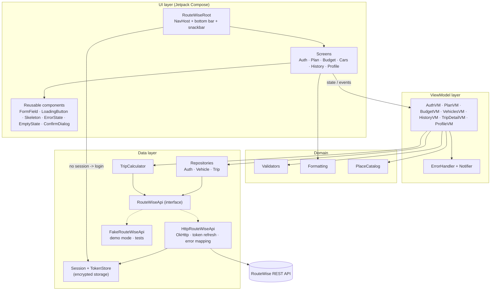
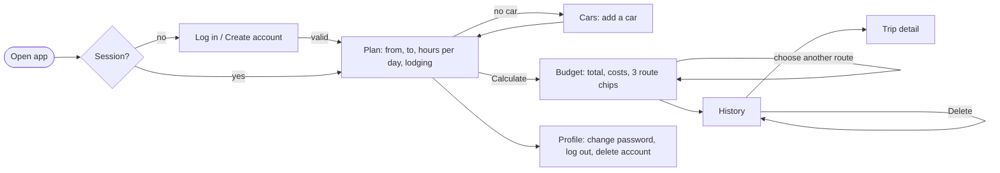

# RouteWise – Android client

Android application of the RouteWise trip-cost planner. It lets a driver register, store cars, choose a start and
a destination, and see what the trip will cost (fuel, road fees, overnight stay) for three route variants. It
talks to the RouteWise REST API described in [`docs/api`](../docs/api/README.md).

Status of this document: it describes the code in this folder. Everything that is not implemented is listed in
[Limitations](#limitations).

## 1. What you can check

| Criterion | Where it is implemented |
|---|---|
| Modern framework | Kotlin + Jetpack Compose + Material 3 (`app/src/main/java/com/routewise/app/ui`) |
| Component-based structure | Screens in `ui/<feature>`, reusable components in `ui/components`, API and business logic in `data` |
| MVVM | Every screen has a `ViewModel` exposing `StateFlow` state; screens only render state and send events |
| Forms with validation | `ui/auth`, `ui/vehicles`, `ui/plan`, `ui/profile`; the rules are in `domain/Validators.kt` |
| Global error handling | `core/ErrorHandler.kt`, `core/Notifier.kt`, snackbar host in `ui/navigation/RouteWiseRoot.kt` |
| Loading states / skeletons | `ui/components/Components.kt` (`SkeletonList`, `SkeletonBox`, `LoadingButton`) |
| 401 / 403 / 404 / 500 handling | `data/api/ApiException.kt` maps status and error code, `HttpRouteWiseApi` renews the token on 401 |
| Typed API layer | `data/api/ApiModels.kt` (DTOs), `RouteWiseApi.kt` (interface), `HttpRouteWiseApi.kt` (HTTP) |
| No tokens in code | Tokens are received at run time and kept in `EncryptedSharedPreferences` (`data/session/Session.kt`) |
| Unit tests (>= 3 components) | `app/src/test/.../domain`, `.../data`, `.../ui` – 37 tests, see [Tests](#5-tests) |
| UI / e2e tests | `app/src/test/.../ui/AppFlowTest.kt` – 2 tests with Compose test and Robolectric |

## 2. How to get and run the app

### 2.1 Without installing anything: the APK

Every push to `main` that touches `android/` runs the workflow **Android** (`.github/workflows/android.yml`). Open
the run in the *Actions* tab and download the artifact **routewise-debug-apk**. Install the `.apk` on a phone or an
emulator (Android 8.0 / API 26 or newer).

The APK is built in **demo mode**: the app uses built-in sample data and needs no server. Log in with

- e-mail `demo@routewise.app`, password `demo-password-1`, or create any new account.

Demo figures are illustrative (straight-line distance, fixed sample prices); they are not real prices.

### 2.2 Build it yourself

Requirements: JDK 17, Android SDK 34 (Android Studio Koala or newer installs both).

```bash
cd android
./gradlew testDebugUnitTest        # unit and UI tests
./gradlew assembleDebug            # app/build/outputs/apk/debug/app-debug.apk
```

### 2.3 Use the real back-end

Start the back-end (`docker compose up -d --build`, see the root README), then build with the demo mode switched
off. `10.0.2.2` is how an Android emulator reaches the computer it runs on:

```bash
./gradlew assembleDebug -PdemoMode=false -PapiBaseUrl=http://10.0.2.2:8000/
```

The base URL is a build setting, not a constant in the code. Clear-text HTTP is allowed only for `10.0.2.2` and
`localhost` (`res/xml/network_security_config.xml`); a public server must use HTTPS.

## 3. Architecture



Rules that keep the layers apart:

- A screen never calls the network. It collects the `StateFlow` of its view model and calls its functions.
- A view model never knows about HTTP. It uses repositories and `TripCalculator`, which depend only on the
  `RouteWiseApi` interface.
- `HttpRouteWiseApi` is the only class that uses OkHttp. It adds the bearer token, repeats a request once after
  renewing the token, converts every failure to an `ApiException` and logs method, path and status, never bodies.
- `AppContainer` (manual dependency injection) decides at start-up whether the app talks to the server or to
  `FakeRouteWiseApi`. Tests build their own container.

### Global error handling

| Situation | What happens |
|---|---|
| Field is invalid | The form shows the message under the field and does not call the server |
| 401 on a call | The client renews the token once and repeats the call (one refresh for concurrent calls, guarded by a mutex) |
| Renewal refused | The session is cleared; the root shows the login screen with "Your session has ended. Log in again." |
| 403 | "You are not allowed to do this." (snackbar) |
| 404 | "This item no longer exists." (snackbar) |
| 422 `no_route` | "No road route found. Move the marker to a road and try again." |
| 5xx / 502 | "The service is not available now. Try again in a few minutes." |
| No connection | "No connection. Check your internet connection and try again." |
| Loading a screen fails | The screen shows the message and a **Try again** button |
| Action in a dialog fails | The dialog stays open and a snackbar explains why |

The branch is on the stable `error.code` of the API and falls back to the HTTP status (see
[`docs/api/guides/errors.md`](../docs/api/guides/errors.md)).

## 4. User flows



1. **Register / log in (SCR-01).** E-mail format, password length (10–128) and the privacy checkbox are checked
   before sending. A taken e-mail is shown on the e-mail field; a wrong password shows one neutral message.
2. **Cars (SCR-02).** Add, edit, delete (with confirmation) and make default. Consumption 2.0–30.0 l/100 km,
   tank empty or 20–120 l, name 1–60 characters. A comma is accepted as the decimal separator.
3. **Plan (SCR-03).** Type at least three letters of a city and pick it from the list. The day limit is 4–10 h.
   Without a car the screen says so and leads to *Cars*.
4. **Budget (SCR-04).** Total, distance, duration, nights and every cost line. Estimated or missing figures are
   labelled, never shown as exact. The chips compare the three route variants with the fastest one.
5. **History and detail (SCR-06).** Newest first, delete with confirmation, open a trip to see its full breakdown.
6. **Profile (SCR-07).** Change password, log out, delete the account (with confirmation).
7. **States (SCR-08).** Skeleton while loading, message with retry on failure, hint with an action when empty.

## 5. Tests

Run with `./gradlew testDebugUnitTest`. All tests run on the JVM; no emulator is needed.

| Test class | Component | Tests |
|---|---|---|
| `ValidatorsTest` | validation rules | 9 |
| `FormattingTest` | money, time and name formatting | 4 |
| `HttpRouteWiseApiTest` | API client against a mock HTTP server: bearer header, token refresh and retry, failed refresh, 403/404/422/500 mapping, unreachable server | 9 |
| `TripCalculatorTest` | one history entry per calculation, switching the route, deltas | 4 |
| `AuthViewModelTest` | form validation, wrong password, taken e-mail, successful login | 5 |
| `VehiclesViewModelTest` | list, invalid form, add, delete with confirmation | 4 |
| `AppFlowTest` | UI: validation messages on the login screen. End to end: log in, plan Vilnius → Warsaw, see the total and the route chips | 2 |

## 6. Technology choices

| Choice | Why |
|---|---|
| Kotlin, Jetpack Compose, Material 3 | The platform's recommended UI toolkit; declarative UI makes loading/error/empty states plain `when` branches |
| MVVM with `StateFlow` | One immutable state object per screen; view models are testable without a device |
| Navigation Compose | Type-checked routes, back stack and tab state handled by the library |
| OkHttp + kotlinx.serialization | A small, well-known HTTP client; serialization is checked at compile time, no reflection |
| Manual dependency injection (`AppContainer`) | Seven screens do not justify Hilt; the container is one short file and the dependencies stay visible |
| `FakeRouteWiseApi` | Demo mode for a reviewer without a server, and a fast, deterministic test double |
| `EncryptedSharedPreferences` | Tokens are encrypted with a key from the Android Keystore |
| Robolectric + Compose test | UI tests run in CI without an emulator |

## 7. Limitations

- **The map, address search, weather, alternatives view, administration and screens SCR-05, SCR-09–SCR-12 of
  the UX specification are not implemented.** Places are chosen from a built-in list of 23 cities in LT, LV, EE,
  PL, DE, DK, CZ, SK (`domain/Places.kt`). The API accepts any coordinates; only the picker is limited.
- The API returns one route per request. To compare three variants the app sends three requests, keeps the
  selected one in the history and deletes the others (`data/TripCalculator.kt`). If a deletion fails the user may
  see an extra entry in the history.
- The overnight stop city and the refuel plan returned by the API are not shown on a map; the refuel plan is not
  requested because the start fuel level has no input yet.
- Demo mode produces approximate figures from straight-line distance. Real figures need the back-end with a routing
  engine.
- The release build is not signed and not obfuscated; only the debug APK is produced.
- Adaptive layouts for tablets are not covered.
