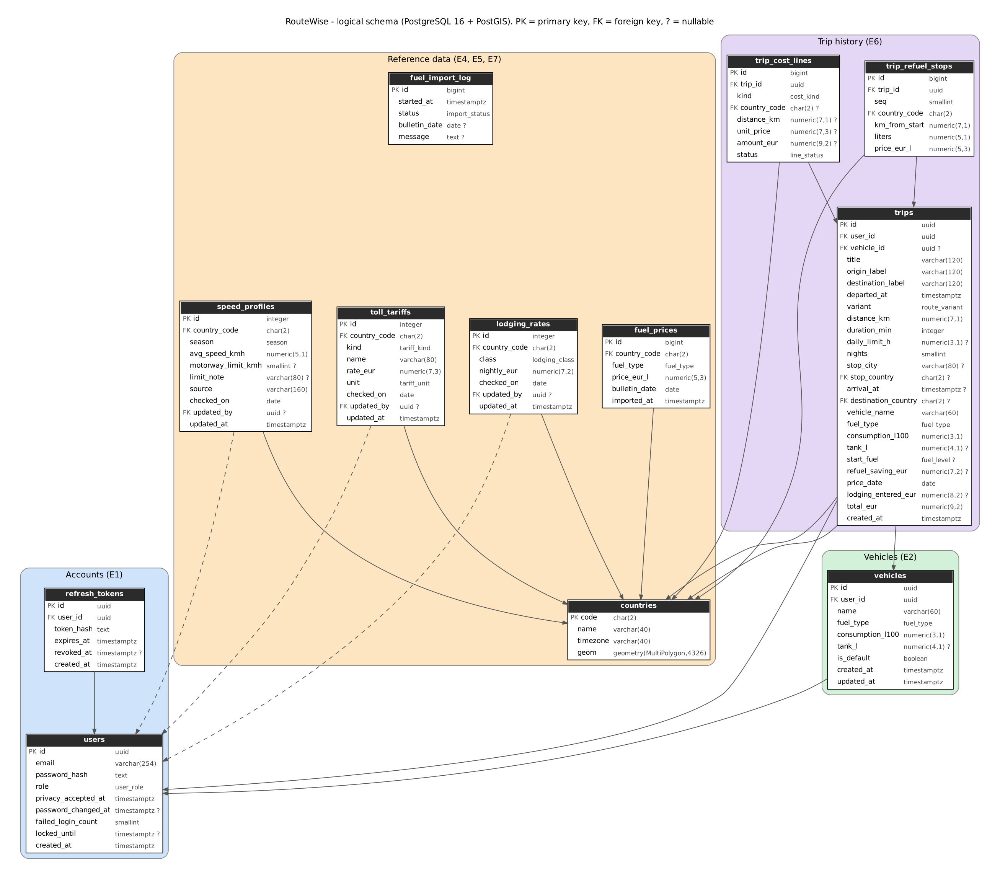

# Data dictionary — RouteWise

DBMS: **PostgreSQL 16 + PostGIS 3** (extensions `postgis`, `pgcrypto`), schema `rw`. Track: OLTP (many small transactions: login, save a trip, read history).

## Layers

| Layer | Colour in the diagram | Tables | Who changes it |
|---|---|---|---|
| Accounts (E1) | blue | `users`, `refresh_tokens` | the user, through functions |
| Vehicles (E2) | green | `vehicles` | the user |
| Reference data (E4, E5, E7) | orange | `countries`, `fuel_prices`, `fuel_import_log`, `toll_tariffs`, `lodging_rates`, `speed_profiles` | the weekly import and the administrator |
| Trip history (E6) | violet | `trips`, `trip_cost_lines`, `trip_refuel_stops` | created once when a trip is saved; afterwards read-only (except the title) |

Why layers: reference data changes rarely and is read by everybody; user data is private and protected by row-level security; history must never change after saving. Each layer therefore gets different privileges (see `security.md`).

A separate analytical layer is **not** needed: the app is OLTP, and reporting is covered by views (`v_*`) and one materialized view.

## Enumerations (ENUM types)

| Type | Values | Used in |
|---|---|---|
| `user_role` | user, admin | users.role |
| `fuel_type` | petrol95, diesel | vehicles, fuel_prices, trips |
| `route_variant` | fastest, shortest, no_tolls | trips.variant |
| `tariff_kind` | toll, vignette | toll_tariffs.kind |
| `tariff_unit` | per_km, per_trip | toll_tariffs.unit |
| `lodging_class` | economy, standard, comfort | lodging_rates.class |
| `season` | summer, winter | speed_profiles.season |
| `cost_kind` | fuel, road, lodging | trip_cost_lines.kind |
| `line_status` | ok, no_data, estimate, eu_average, user_entered | trip_cost_lines.status |
| `import_status` | ok, failed | fuel_import_log.status |
| `fuel_level` | full, three_quarter, half, quarter | trips.start_fuel |

Enumerations are used instead of lookup tables because the sets are small, fixed by the product (changing them changes application code too) and checked by the database without a join.

## Tables

Generated from the live schema by `docs/tools/gen_docs.py` (types, keys and nullability come from the database catalog; descriptions are written by hand).
Legend: **PK** primary key, **FK** foreign key (`-> table`), **UQ** part of a unique constraint, **NN** NOT NULL. Money is `numeric`, times are `timestamptz`.

## Layer: Accounts (E1)

### `users`

Registered people and administrators of the app. The only table with personal data (e-mail).

| Column | Type | Keys | Null | Default | Meaning |
|---|---|---|---|---|---|
| `id` | uuid | PK | NN | gen_random_uuid() | Surrogate key (UUID, not guessable). |
| `email` | character varying(254) |  | NN |  | Login name; stored lower case. Personal data (masked in reports). |
| `password_hash` | text |  | NN |  | bcrypt hash made by pgcrypto `crypt()`; never readable by the application role. |
| `role` | rw.user_role |  | NN | 'user'::rw.user_role | `user` or `admin` (application-level administrator). |
| `privacy_accepted_at` | timestamp with time zone |  | NN |  | When the privacy notice was accepted (US-01). |
| `password_changed_at` | timestamp with time zone |  | null |  | Last password change (US-19). |
| `failed_login_count` | smallint |  | NN | 0 | Consecutive failed logins (US-02). |
| `locked_until` | timestamp with time zone |  | null |  | Account locked until this moment after 5 failures in a row. |
| `created_at` | timestamp with time zone |  | NN | now() | Registration time. |

**Constraints**

- `users_email_format`: `CHECK ((((email)::text = lower((email)::text)) AND ((email)::text ~ '^[^@\s]+@[^@\s]+\.[^@\s]+$'::text)))`
- `users_failed_nonneg`: `CHECK ((failed_login_count >= 0))`
- `users_hash_format`: `CHECK ((password_hash ~ '^\$(2[aby]\$[0-9]{2}\$|argon2id\$)'::text))`

**Data-quality expectations**

- `email` is lower case, valid format, unique.
- `password_hash` is a bcrypt/argon2id hash (CHECK); the plain password never reaches the database tables.
- `failed_login_count` between 0 and 5; `locked_until` is set only after 5 failures.

### `refresh_tokens`

Long-lived login tokens (US-02). Only a hash of the token is stored.

| Column | Type | Keys | Null | Default | Meaning |
|---|---|---|---|---|---|
| `id` | uuid | PK | NN | gen_random_uuid() | Surrogate key. |
| `user_id` | uuid | FK -> users | NN |  | Owner; deleted together with the user. |
| `token_hash` | text | UQ | NN |  | Hash of the token (the token itself is never stored). |
| `expires_at` | timestamp with time zone |  | NN |  | Expiry time. |
| `revoked_at` | timestamp with time zone |  | null |  | Set on logout or password change. |
| `created_at` | timestamp with time zone |  | NN | now() | Issue time. |

**Constraints**

- `refresh_tokens_expiry`: `CHECK ((expires_at > created_at))`
- `refresh_tokens_user_id_fkey`: `FOREIGN KEY (user_id) REFERENCES rw.users(id) ON DELETE CASCADE`
- `refresh_tokens_token_hash_key`: `UNIQUE (token_hash)`

**Data-quality expectations**

- `expires_at` is after `created_at`.
- A revoked or expired token is never accepted by the backend.

## Layer: Vehicles (E2)

### `vehicles`

Vehicles of a user: fuel type, consumption, optional tank size (US-03, US-30).

| Column | Type | Keys | Null | Default | Meaning |
|---|---|---|---|---|---|
| `id` | uuid | PK | NN | gen_random_uuid() | Surrogate key. |
| `user_id` | uuid | FK -> users | NN |  | Owner. |
| `name` | character varying(60) |  | NN |  | Display name, e.g. 'Skoda Octavia'. |
| `fuel_type` | rw.fuel_type |  | NN |  | `petrol95` or `diesel`. |
| `consumption_l100` | numeric(3,1) |  | NN |  | Entered consumption, litres per 100 km, used as is. |
| `tank_l` | numeric(4,1) |  | null |  | Tank size in litres; NULL means no refuel plan. |
| `is_default` | boolean |  | NN | false | Pre-selected vehicle. |
| `created_at` | timestamp with time zone |  | NN | now() | Creation time. |
| `updated_at` | timestamp with time zone |  | NN | now() | Set by trigger on every update. |

**Constraints**

- `vehicles_consumption_l100_check`: `CHECK (((consumption_l100 >= 2.0) AND (consumption_l100 <= 30.0)))`
- `vehicles_name_check`: `CHECK ((length(btrim((name)::text)) > 0))`
- `vehicles_tank_l_check`: `CHECK (((tank_l >= (20)::numeric) AND (tank_l <= (120)::numeric)))`
- `vehicles_user_id_fkey`: `FOREIGN KEY (user_id) REFERENCES rw.users(id) ON DELETE CASCADE`

**Data-quality expectations**

- `consumption_l100` 2.0-30.0; `tank_l` 20-120 or NULL.
- At most one default vehicle per user (partial unique index + trigger).

## Layer: Reference data (E4, E5, E7)

### `countries`

The 8 supported countries with border geometry (km per country, US-07) and time zone (US-29).

| Column | Type | Keys | Null | Default | Meaning |
|---|---|---|---|---|---|
| `code` | character(2) | PK | NN |  | ISO 3166-1 alpha-2 code (natural key). |
| `name` | character varying(40) | UQ | NN |  | English name. |
| `timezone` | character varying(40) |  | NN |  | IANA zone, e.g. Europe/Vilnius. |
| `geom` | geometry(MultiPolygon,4326) |  | NN |  | Border geometry, SRID 4326. |

**Constraints**

- `countries_code_check`: `CHECK (((code)::text = upper((code)::text)))`
- `countries_timezone_check`: `CHECK (((timezone)::text ~ '^[A-Za-z]+/[A-Za-z_]+$'::text))`
- `countries_name_key`: `UNIQUE (name)`

**Data-quality expectations**

- Exactly the 8 supported countries; `geom` is a valid MultiPolygon in SRID 4326.

### `fuel_prices`

Weekly national average fuel prices from the EC Weekly Oil Bulletin; history is kept (US-09, US-31).

| Column | Type | Keys | Null | Default | Meaning |
|---|---|---|---|---|---|
| `id` | bigint | PK | NN | identity | Surrogate key. |
| `country_code` | character(2) | FK -> countries, UQ | NN |  | Country. |
| `fuel_type` | rw.fuel_type | UQ | NN |  | Fuel. |
| `price_eur_l` | numeric(5,3) |  | NN |  | EUR per litre, 3 decimals. |
| `bulletin_date` | date | UQ | NN |  | Date of the EC bulletin the price comes from. |
| `imported_at` | timestamp with time zone |  | NN | now() | When the row was loaded. |

**Constraints**

- `fuel_prices_price_eur_l_check`: `CHECK (((price_eur_l >= 0.500) AND (price_eur_l <= 4.000)))`
- `fuel_prices_country_code_fkey`: `FOREIGN KEY (country_code) REFERENCES rw.countries(code)`
- `fuel_prices_uq`: `UNIQUE (country_code, fuel_type, bulletin_date)`

**Data-quality expectations**

- `price_eur_l` between 0.500 and 4.000 EUR/l (sanity range).
- One value per country, fuel and bulletin week (UNIQUE).
- Freshness: the newest `bulletin_date` is at most 14 days old; otherwise the app shows the data age (US-12).

### `fuel_import_log`

Result of every weekly import; a failed import leaves the old prices in place (US-21).

| Column | Type | Keys | Null | Default | Meaning |
|---|---|---|---|---|---|
| `id` | bigint | PK | NN | identity | Surrogate key. |
| `started_at` | timestamp with time zone |  | NN | now() | Import start. |
| `status` | rw.import_status |  | NN |  | `ok` or `failed`. |
| `bulletin_date` | date |  | null |  | Bulletin date (NULL for failures). |
| `message` | text |  | null |  | Error text or note. |

**Constraints**

- `fuel_import_ok_has_date`: `CHECK (((status <> 'ok'::rw.import_status) OR (bulletin_date IS NOT NULL)))`

**Data-quality expectations**

- A successful import always has a bulletin date.

### `toll_tariffs`

Road charges for passenger cars (tolls and vignettes) entered by the administrator (US-10, US-25).

| Column | Type | Keys | Null | Default | Meaning |
|---|---|---|---|---|---|
| `id` | integer | PK | NN | identity | Surrogate key. |
| `country_code` | character(2) | FK -> countries, UQ | NN |  | Country. |
| `kind` | rw.tariff_kind | UQ | NN |  | `toll` or `vignette`. |
| `name` | character varying(80) | UQ | NN |  | Road section or product name. |
| `rate_eur` | numeric(7,3) |  | NN |  | Rate in EUR. |
| `unit` | rw.tariff_unit |  | NN |  | `per_km` or `per_trip`. |
| `checked_on` | date |  | NN |  | Date the value was verified. |
| `updated_by` | uuid | FK -> users | null |  | Administrator who changed the row (kept NULL if that user is deleted). |
| `updated_at` | timestamp with time zone |  | NN | now() | Set by trigger. |

**Constraints**

- `toll_tariffs_rate_eur_check`: `CHECK ((rate_eur >= (0)::numeric))`
- `toll_tariffs_country_code_fkey`: `FOREIGN KEY (country_code) REFERENCES rw.countries(code)`
- `toll_tariffs_updated_by_fkey`: `FOREIGN KEY (updated_by) REFERENCES rw.users(id) ON DELETE SET NULL`
- `toll_tariffs_uq`: `UNIQUE (country_code, kind, name)`

**Data-quality expectations**

- `rate_eur` >= 0; `checked_on` is the date the administrator verified the value.
- No row for a country means 'no data' in the app.

### `lodging_rates`

Typical nightly price per country and class (US-14, US-25).

| Column | Type | Keys | Null | Default | Meaning |
|---|---|---|---|---|---|
| `id` | integer | PK | NN | identity | Surrogate key. |
| `country_code` | character(2) | FK -> countries, UQ | NN |  | Country. |
| `class` | rw.lodging_class | UQ | NN |  | `economy`, `standard`, `comfort`. |
| `nightly_eur` | numeric(7,2) |  | NN |  | EUR per night. |
| `checked_on` | date |  | NN |  | Verification date. |
| `updated_by` | uuid | FK -> users | null |  | Administrator. |
| `updated_at` | timestamp with time zone |  | NN | now() | Set by trigger. |

**Constraints**

- `lodging_rates_nightly_eur_check`: `CHECK ((nightly_eur > (0)::numeric))`
- `lodging_rates_country_code_fkey`: `FOREIGN KEY (country_code) REFERENCES rw.countries(code)`
- `lodging_rates_updated_by_fkey`: `FOREIGN KEY (updated_by) REFERENCES rw.users(id) ON DELETE SET NULL`
- `lodging_rates_uq`: `UNIQUE (country_code, class)`

**Data-quality expectations**

- `nightly_eur` > 0; one row per country and class.

### `speed_profiles`

Average speed and motorway limit per country and season (US-26).

| Column | Type | Keys | Null | Default | Meaning |
|---|---|---|---|---|---|
| `id` | integer | PK | NN | identity | Surrogate key. |
| `country_code` | character(2) | FK -> countries, UQ | NN |  | Country. |
| `season` | rw.season | UQ | NN |  | `summer` or `winter` (winter = 1 Nov - 31 Mar). |
| `avg_speed_kmh` | numeric(5,1) |  | NN |  | Average speed used for the travel time. |
| `motorway_limit_kmh` | smallint |  | null |  | Motorway limit; NULL = no general limit. |
| `limit_note` | character varying(80) |  | null |  | Short note shown with the limit. |
| `source` | character varying(160) |  | NN |  | Where the administrator verified the values. |
| `checked_on` | date |  | NN |  | Verification date. |
| `updated_by` | uuid | FK -> users | null |  | Administrator. |
| `updated_at` | timestamp with time zone |  | NN | now() | Set by trigger. |

**Constraints**

- `speed_profiles_avg_le_limit`: `CHECK (((motorway_limit_kmh IS NULL) OR (avg_speed_kmh <= (motorway_limit_kmh)::numeric)))`
- `speed_profiles_avg_speed_kmh_check`: `CHECK (((avg_speed_kmh >= (30)::numeric) AND (avg_speed_kmh <= (130)::numeric)))`
- `speed_profiles_motorway_limit_kmh_check`: `CHECK (((motorway_limit_kmh >= 50) AND (motorway_limit_kmh <= 160)))`
- `speed_profiles_country_code_fkey`: `FOREIGN KEY (country_code) REFERENCES rw.countries(code)`
- `speed_profiles_updated_by_fkey`: `FOREIGN KEY (updated_by) REFERENCES rw.users(id) ON DELETE SET NULL`
- `speed_profiles_uq`: `UNIQUE (country_code, season)`

**Data-quality expectations**

- `avg_speed_kmh` 30-130 and not above `motorway_limit_kmh`.
- `source` is mandatory: where the value was verified.
- No row means the routing-engine duration is used.

## Layer: Trip history (E6)

### `trips`

Saved calculation (history, US-16/17). Immutable except the title; keeps a snapshot of the vehicle.

| Column | Type | Keys | Null | Default | Meaning |
|---|---|---|---|---|---|
| `id` | uuid | PK | NN | gen_random_uuid() | Surrogate key. |
| `user_id` | uuid | FK -> users | NN |  | Owner; trips are deleted with the user (US-20). |
| `vehicle_id` | uuid | FK -> vehicles | null |  | Vehicle used; becomes NULL if the vehicle is deleted (US-04). |
| `title` | character varying(120) |  | NN |  | Name in the history list (editable). |
| `origin_label` | character varying(120) |  | NN |  | Origin as text; no coordinates are stored. |
| `destination_label` | character varying(120) |  | NN |  | Destination as text. |
| `departed_at` | timestamp with time zone |  | NN |  | Device clock at calculation (US-29). |
| `variant` | rw.route_variant |  | NN | 'fastest'::rw.route_variant | `fastest`, `shortest`, `no_tolls`. |
| `distance_km` | numeric(7,1) |  | NN |  | Route length. |
| `duration_min` | integer |  | NN |  | Driving time in minutes. |
| `daily_limit_h` | numeric(3,1) |  | null |  | Daily driving limit 4-10 h (US-08). |
| `nights` | smallint |  | NN | 0 | Number of overnight stops. |
| `stop_city` | character varying(80) |  | null |  | Overnight stop city (US-13). |
| `stop_country` | character(2) | FK -> countries | null |  | Country of the stop. |
| `arrival_at` | timestamp with time zone |  | null |  | Arrival moment (shown in destination local time). |
| `destination_country` | character(2) | FK -> countries | null |  | Destination country (time zone for arrival). |
| `vehicle_name` | character varying(60) |  | NN |  | Snapshot of the vehicle name. |
| `fuel_type` | rw.fuel_type |  | NN |  | Snapshot of the fuel type. |
| `consumption_l100` | numeric(3,1) |  | NN |  | Snapshot of consumption. |
| `tank_l` | numeric(4,1) |  | null |  | Snapshot of tank size. |
| `start_fuel` | rw.fuel_level |  | null |  | Start level for the refuel plan (US-30). |
| `refuel_saving_eur` | numeric(7,2) |  | null |  | Estimated saving of the refuel tip; not part of the total. |
| `price_date` | date |  | NN |  | Oldest bulletin date used. |
| `lodging_entered_eur` | numeric(8,2) |  | null |  | Lodging total typed by the user (US-24); NULL = estimate. |
| `total_eur` | numeric(9,2) |  | NN |  | Sum of visible cost lines. |
| `created_at` | timestamp with time zone |  | NN | now() | Save time. |

**Constraints**

- `trips_arrival_after_departure`: `CHECK (((arrival_at IS NULL) OR (arrival_at >= departed_at)))`
- `trips_consumption_l100_check`: `CHECK (((consumption_l100 >= 2.0) AND (consumption_l100 <= 30.0)))`
- `trips_daily_limit_h_check`: `CHECK (((daily_limit_h >= (4)::numeric) AND (daily_limit_h <= (10)::numeric)))`
- `trips_distance_km_check`: `CHECK ((distance_km > (0)::numeric))`
- `trips_duration_min_check`: `CHECK ((duration_min > 0))`
- `trips_lodging_entered_eur_check`: `CHECK ((lodging_entered_eur > (0)::numeric))`
- `trips_nights_check`: `CHECK ((nights >= 0))`
- `trips_nights_need_stop`: `CHECK (((nights = 0) OR (daily_limit_h IS NOT NULL)))`
- `trips_refuel_needs_tank`: `CHECK (((start_fuel IS NULL) OR (tank_l IS NOT NULL)))`
- `trips_tank_l_check`: `CHECK (((tank_l >= (20)::numeric) AND (tank_l <= (120)::numeric)))`
- `trips_total_eur_check`: `CHECK ((total_eur >= (0)::numeric))`
- `trips_destination_country_fkey`: `FOREIGN KEY (destination_country) REFERENCES rw.countries(code)`
- `trips_stop_country_fkey`: `FOREIGN KEY (stop_country) REFERENCES rw.countries(code)`
- `trips_user_id_fkey`: `FOREIGN KEY (user_id) REFERENCES rw.users(id) ON DELETE CASCADE`
- `trips_vehicle_id_fkey`: `FOREIGN KEY (vehicle_id) REFERENCES rw.vehicles(id) ON DELETE SET NULL`

**Data-quality expectations**

- `total_eur` equals the sum of its cost lines (checked at COMMIT).
- `arrival_at` is not before `departed_at`.
- A trip's vehicle belongs to the same user; no coordinates are stored (labels are text only).

### `trip_cost_lines`

Cost breakdown of a trip: fuel per country, road charges, lodging.

| Column | Type | Keys | Null | Default | Meaning |
|---|---|---|---|---|---|
| `id` | bigint | PK | NN | identity | Surrogate key. |
| `trip_id` | uuid | FK -> trips | NN |  | Trip. |
| `kind` | rw.cost_kind |  | NN |  | `fuel`, `road`, `lodging`. |
| `country_code` | character(2) | FK -> countries | null |  | Country of the line. |
| `distance_km` | numeric(7,1) |  | null |  | Km in this country (fuel/road). |
| `unit_price` | numeric(7,3) |  | null |  | EUR/l, rate or nightly rate. |
| `amount_eur` | numeric(9,2) |  | null |  | Amount; NULL when no data. |
| `status` | rw.line_status |  | NN | 'ok'::rw.line_status | `ok`, `no_data`, `estimate`, `eu_average`, `user_entered`. |

**Constraints**

- `cost_lines_no_data_has_no_amount`: `CHECK (((status = 'no_data'::rw.line_status) = (amount_eur IS NULL)))`
- `trip_cost_lines_amount_eur_check`: `CHECK ((amount_eur >= (0)::numeric))`
- `trip_cost_lines_distance_km_check`: `CHECK ((distance_km >= (0)::numeric))`
- `trip_cost_lines_unit_price_check`: `CHECK ((unit_price >= (0)::numeric))`
- `trip_cost_lines_country_code_fkey`: `FOREIGN KEY (country_code) REFERENCES rw.countries(code)`
- `trip_cost_lines_trip_id_fkey`: `FOREIGN KEY (trip_id) REFERENCES rw.trips(id) ON DELETE CASCADE`

**Data-quality expectations**

- `amount_eur` is NULL exactly when `status` = 'no_data'.

### `trip_refuel_stops`

Refuel plan of a trip (US-30): where and how much to refuel. A tip, not part of the total.

| Column | Type | Keys | Null | Default | Meaning |
|---|---|---|---|---|---|
| `id` | bigint | PK | NN | identity | Surrogate key. |
| `trip_id` | uuid | FK -> trips, UQ | NN |  | Trip. |
| `seq` | smallint | UQ | NN |  | Order of the stop (1, 2, ...). |
| `country_code` | character(2) | FK -> countries | NN |  | Country of the stop. |
| `km_from_start` | numeric(7,1) |  | NN |  | Distance from the origin. |
| `liters` | numeric(5,1) |  | NN |  | Litres to refuel. |
| `price_eur_l` | numeric(5,3) |  | NN |  | National average price used. |

**Constraints**

- `trip_refuel_stops_km_from_start_check`: `CHECK ((km_from_start >= (0)::numeric))`
- `trip_refuel_stops_liters_check`: `CHECK ((liters > (0)::numeric))`
- `trip_refuel_stops_price_eur_l_check`: `CHECK (((price_eur_l >= 0.500) AND (price_eur_l <= 4.000)))`
- `trip_refuel_stops_seq_check`: `CHECK ((seq > 0))`
- `trip_refuel_stops_country_code_fkey`: `FOREIGN KEY (country_code) REFERENCES rw.countries(code)`
- `trip_refuel_stops_trip_id_fkey`: `FOREIGN KEY (trip_id) REFERENCES rw.trips(id) ON DELETE CASCADE`
- `trip_refuel_stops_uq`: `UNIQUE (trip_id, seq)`

**Data-quality expectations**

- `seq` unique inside a trip; `liters` > 0; price in the sanity range.

## Views

| View | Purpose | Notes |
|---|---|---|
| `mv_latest_fuel_prices` (materialized) | latest price per country and fuel | refreshed by `finish_fuel_import` after a successful weekly import; unique index allows `REFRESH ... CONCURRENTLY` |
| `v_fuel_price_trend` | last 12 bulletins per country and fuel (US-31) | window function `row_number()` |
| `v_current_speed_profiles` | speed profile of the current season (US-26) | uses `season_for(current_date)` |
| `v_trip_history` | history list with arrival in the destination's local time (US-17, US-29) | `security_invoker`: row-level security of the caller applies |
| `v_trip_cost_summary` | fuel / road / lodging totals per trip | `security_invoker` |
| `v_users_masked` | users with masked e-mail and pseudonym | for reporting; see masking in `security.md` |
| `v_trips_anonymized` | trips without user id, titles, place names | month instead of exact time |

## Functions, procedures, triggers

| Object | Kind | What it does |
|---|---|---|
| `register_user`, `authenticate`, `change_password`, `delete_account` | functions (SECURITY DEFINER) | bcrypt hashing, lock after 5 failures, token revocation, erasure (US-01, 02, 19, 20) |
| `import_fuel_price`, `finish_fuel_import` | procedures | weekly import, log, refresh of the materialized view (US-09, US-21) |
| `consume_refresh_token`, `revoke_refresh_token` | functions (SECURITY DEFINER) | refresh-token rotation without a user context (back-end, US-02) |
| `season_for`, `local_arrival`, `mask_email`, `current_app_user` | functions | helpers |
| `trg_set_updated_at` | trigger | `updated_at` on vehicles and reference tables |
| `trg_vehicle_default`, `trg_vehicle_after_delete` | triggers | exactly one default vehicle per user |
| `trg_password_changed` | trigger | stamps the change and revokes refresh tokens |
| `trg_trip_immutable` | trigger | saved trip is read-only except the title |
| `trg_check_trip_total` | deferred constraint trigger | `total_eur` = sum of cost lines, checked at COMMIT |
| `trg_trip_vehicle_owner` | trigger | trip's vehicle belongs to the same user |
