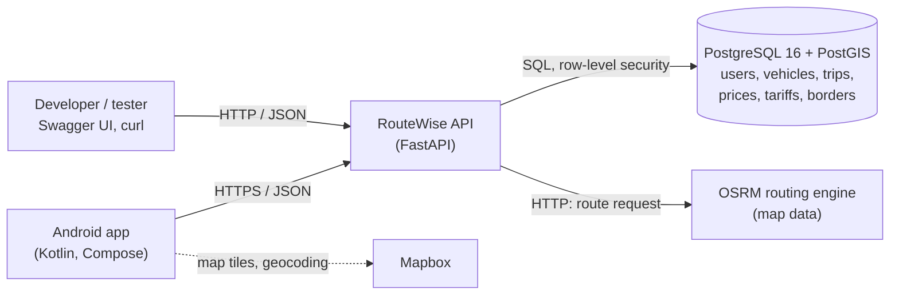
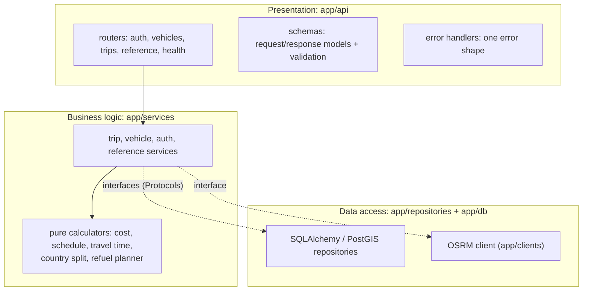

# Architecture overview

## System context

The API is the only component that talks to the database. The routing engine is a separate service; the map
tiles and address search used by the app come directly from a map provider and are not part of this API.

## Layers inside the API

Dependencies point inwards: services know only interfaces, so repositories and the routing client can be replaced
(the unit tests run the real services on in-memory fakes).

## Resources
| Resource | Endpoints | Owner of the data |
|---|---|---|
| Account and tokens | `/auth/*`, `/users/me` | the user |
| Vehicles | `/vehicles`, `/vehicles/{id}` | the user |
| Trips (calculation + history) | `/trips`, `/trips/{id}` | the user |
| Reference data | `/countries`, `/fuel-prices`, `/fuel-prices/{country}/trend`, `/speed-profiles`, `/lodging-rates` | the service (public, read-only) |
| Service | `/health`, `/health/ready` | - |

## Request lifecycle of `POST /trips`
```mermaid
sequenceDiagram
    participant C as Client
    participant A as API (router + service)
    participant O as OSRM
    participant D as PostgreSQL / PostGIS
    C->>A: POST /api/v1/trips (Bearer token, body)
    A->>A: verify token, validate body
    A->>D: BEGIN; set current user (row-level security)
    A->>D: load vehicle (own or default)
    A->>O: GET /route (origin, destination, variant)
    O-->>A: distance, duration, geometry, toll km
    A->>D: split the route by country (PostGIS)
    A->>D: load prices, tariffs, speed profiles, lodging rates
    A->>A: schedule, driving time, cost lines, refuel plan
    A->>D: INSERT trip, lines, refuel stops; COMMIT
    D-->>A: total checked by a database trigger
    A-->>C: 201 + trip (X-Request-ID)
```
If OSRM does not answer, the transaction is rolled back and the client gets `502 upstream_unavailable`; nothing is saved.

## Error and trust boundaries
- Everything from the client is untrusted and validated in the presentation layer.
- The database enforces the same rules again (constraints, triggers, row-level security) as a second line of defence.
- The routing engine is an external dependency: its failure is translated into `502`, never into a wrong price.

## Data model (summary)
`users` own `vehicles` and `trips`; a trip has `trip_cost_lines` and `trip_refuel_stops` and keeps a snapshot of the
vehicle. Reference tables: `countries` (with border geometry), `fuel_prices` (weekly history), `toll_tariffs`,
`lodging_rates`, `speed_profiles`. The complete description is in
[`database/docs/data_dictionary.md`](../../../database/docs/data_dictionary.md).
