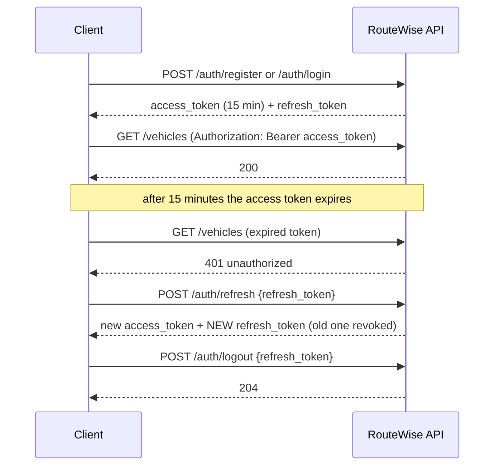

# Authentication and security

## Overview
The API uses **short-lived JWT access tokens** and **single-use refresh tokens**.

| Token | Lifetime | Where it goes | Notes |
|---|---|---|---|
| Access token (JWT, HS256) | 15 minutes | `Authorization: Bearer <token>` on every protected call | Signed with a server secret; contains the user id, the role and the expiry. Not stored by the server. |
| Refresh token | 30 days | request body of `/auth/refresh` and `/auth/logout` | Random 384-bit value. Only its SHA-256 hash is stored. **Works once.** |

Public endpoints (no token): `/health`, `/health/ready`, `/api/v1/auth/*` (except `change-password`),
`/api/v1/countries`, `/api/v1/fuel-prices`, `/api/v1/fuel-prices/{country}/trend`, `/api/v1/speed-profiles`,
`/api/v1/lodging-rates`.

## Flow

## Register and sign in
`POST /api/v1/auth/register` needs `email`, `password` (8-128 characters) and `privacy_accepted: true`.
`POST /api/v1/auth/login` needs `email` and `password`. Both answer with a token pair.

## Refresh (rotation)
Send the refresh token to `POST /api/v1/auth/refresh`. You receive a new access token **and a new refresh
token**; the old refresh token is revoked at once. Store the new one every time.

A refresh token that was already used, revoked or has expired answers `401` with the same message as an
unknown token, so an attacker learns nothing from the difference. If a refresh fails with `401`, the user has to
sign in again.

## Sign out, change password, delete account
- `POST /auth/logout` revokes the given refresh token. It answers `204` also for an unknown or already revoked
  token, so it is safe to call twice. The access token stays valid until it expires (at most 15 minutes).
- `POST /auth/change-password` (needs the old password) changes the password and **revokes all refresh tokens**
  of the user.
- `DELETE /users/me` deletes the account with all its vehicles, trips and tokens. It cannot be undone.

## What the server does to protect users
- **Password hashing.** bcrypt with cost 12, performed inside PostgreSQL; the application never keeps or logs a
  password.
- **Brute force.** Five wrong passwords lock the account for 10 minutes. While it is locked, even the correct
  password answers `401 invalid e-mail or password`: the message is identical, so the response does not reveal
  whether the account exists or is locked.
- **Isolation of users.** The database enforces row-level security: a query can only see rows of the user in the
  token. A foreign resource answers `404`.
- **No secrets in the code.** The signing key and the database passwords come from environment variables.
- **Logs** never contain passwords, tokens or e-mail addresses; each line carries the request id.
- **Input validation.** Every field is type- and range-checked before it reaches the business logic; SQL is
  parameterised.

## Security notes for client developers
- Send tokens only over **HTTPS** in production. The local stack uses plain HTTP for development only.
- Keep the refresh token in secure storage (on Android: the Keystore-backed encrypted storage), never in logs
  or in the URL.
- Treat `401` on a protected call as "try refresh once, then ask the user to sign in".
- Never put the JWT secret, database credentials or a real user's token into a repository, ticket or screenshot.
